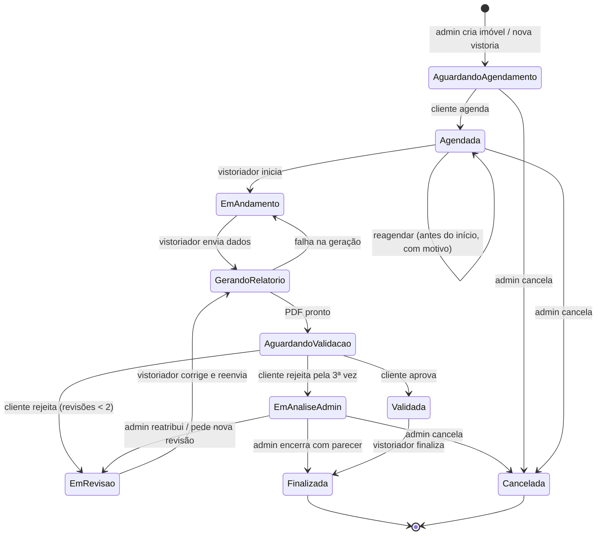

# CIVIS – Planning de Reformulação para Produto

> Objetivo: levar o CIVIS de projeto acadêmico/portfólio a um produto utilizável em produção — seguro, coerente no fluxo, consistente no design e operável (deploy, testes, monitoramento).
>
> Baseado na análise completa do código feita em 25/11/2026 (branch `main`, commit `7924985`).
>
> **Progresso:** Fase 0 concluída · T1 (setup TypeScript) · D1 (usuário único) · S6 · B1 · B2. Próximo: S1, S7, S9 e depois S5 (ordem da Fase 1). Detalhes no [checklist](#checklist-de-acompanhamento).

---

## Sumário

- [Decisões tomadas](#decisões-tomadas)
- [Visão geral das fases](#visão-geral-das-fases)
- [Escopo do MVP (lançamento)](#escopo-do-mvp-lançamento)
- [Convenções](#convenções)
- [Fase 0 – Preparação](#fase-0--preparação)
- [Fase 1 – Segurança e bugs bloqueantes](#fase-1--segurança-e-bugs-bloqueantes)
- [Fase 2 – Fluxo de negócio e modelo de dados](#fase-2--fluxo-de-negócio-e-modelo-de-dados)
- [Fase 3 – Produto, design e UX](#fase-3--produto-design-e-ux)
- [Fase 4 – Operação e qualidade](#fase-4--operação-e-qualidade)
- [Trilha transversal – Migração para TypeScript](#trilha-transversal--migração-para-typescript)
- [Backlog futuro (pós-lançamento)](#backlog-futuro-pós-lançamento)
- [Máquina de estados alvo da vistoria](#máquina-de-estados-alvo-da-vistoria)
- [Riscos e decisões em aberto](#riscos-e-decisões-em-aberto)
- [Definição de "pronto para produção"](#definição-de-pronto-para-produção)

---

## Decisões tomadas

| # | Tema | Decisão | Impacto no plano |
|---|---|---|---|
| DEC-1 | Identidade dos usuários | **Unificar** `cliente` e `funcionario` numa tabela `usuario` com perfis 1:1. | D1 sobe para a **Fase 1**, antes de S5 (sessão) e S6 (e-mail único). |
| DEC-2 | Atribuição do vistoriador | **Admin atribui opcionalmente**; sem atribuição, a vistoria fica no **pool** e qualquer vistoriador assume. | Define F5. |
| DEC-3 | Rejeição do relatório | Volta para **Em Revisão** com motivo obrigatório; **máximo de 2 revisões**, depois escala para o admin. | Define F2. |
| DEC-4 | Dados existentes | O banco tem **só dados de teste**. | O banco pode ser recriado do zero: sem script de migração de dados, sem janela de manutenção. LGPD (S11) continua P2. |
| DEC-5 | Linguagem | Migrar backend e frontend para **TypeScript (strict)**, de forma **incremental**: todo arquivo criado ou reescrito a partir da Fase 1 já nasce em TS. | Trilha T1–T6, que corre junto das Fases 1–4. T1 entra antes de D1. |

---

## Visão geral das fases

| Fase | Foco | Estimativa | Depende de |
|---|---|---|---|
| 0 | Preparação (limpeza, Docker do Postgres, base de testes) | 3–4 dias | — |
| 1 | Unificação de usuários, segurança e bugs que quebram o sistema | 2 semanas | 0 |
| 2 | Fluxo de negócio, modelo de dados, e-mails, relatório | 2–2,5 semanas | 1 |
| 3 | Design system, UX, telas novas, mobile do vistoriador | 3 semanas | 1 (pode correr em paralelo com 2 a partir da metade) |
| 4 | Operação: migrations, CI, deploy, observabilidade | 1 semana | 2 |
| T | Migração para TypeScript (trilha transversal, junto das Fases 1–4) | +1–1,5 semana diluída | 0 |

**Total estimado:** 9–11,5 semanas (incluindo a trilha TypeScript) para 1 desenvolvedor em tempo integral (o dobro em meio período). O MVP (seção abaixo) sai em cerca de 7–8 semanas.

Prioridades: **P0** = bloqueia uso/expõe dados · **P1** = necessário para lançar · **P2** = desejável no lançamento · **P3** = pós-lançamento.

---

## Escopo do MVP (lançamento)

Entra no lançamento **tudo que é P0 e P1**, exceto o que está marcado abaixo como adiado.

| Entra | Adiado para depois do lançamento |
|---|---|
| Fase 0 inteira | S11 (LGPD completo), S12 |
| Fase 1 inteira (S1–S10, D1, B1–B14) | D6, F6, F7 |
| Fase 2: D2–D5, F1–F5, F8, R1, R2, E1–E3 | R3 (layout avançado do PDF), R4, R5 |
| Fase 3: U1–U10 | E4, E5, E6 |
| Fase 4: O1–O6 | U11–U14, O7–O10 |
| TypeScript: T1–T5 | T6 (remover `allowJs`, zero `.js` em `src`) |

Regra: uma tarefa adiada só entra no MVP se outra sair, para o prazo não crescer.

---

## Convenções

- Cada tarefa tem **ID**, prioridade, arquivos afetados e **critério de aceite**.
- **Git:** trabalho direto na `main`, **um commit simples por grupo de tarefas** (ex.: `feat: sessão segura com cookies (S5)`). Sem branches remotas nem PRs por enquanto; o commit e o push são feitos pelo desenvolvedor.
- **Sem atribuição de IA nos commits:** nenhuma linha `Co-Authored-By` ou "Generated with" (configurado em `attribution` no settings do Claude Code). Um commit assim já chegou à `main` uma vez e precisou de reescrita do histórico.
- Antes de cada commit: `typecheck`, `lint`, `test` e `build` verdes nos dois projetos.
- Nenhuma tarefa é dada como concluída sem teste automatizado cobrindo o comportamento (a partir da Fase 0).
- **TypeScript (DEC-5):** a partir da Fase 1, todo arquivo novo ou reescrito em uma tarefa é `.ts`/`.tsx`. Arquivo só tocado de leve (1–2 linhas) pode continuar `.js` até a sua fase.
- Padronizar respostas de erro da API: `{ "erro": { "codigo": "STRING", "mensagem": "texto" } }` (hoje mistura `erro` e `error`).

---

## Fase 0 – Preparação

| ID | Prio | Tarefa | Critério de aceite |
|---|---|---|---|
| F0.1 | P0 | Remover arquivos de teste commitados em `backend/uploads/clientes/` e `backend/uploads/funcionarios/` (imagens reais/teste) e revisar `.gitignore`. | `git ls-files backend/uploads` mostra só `.gitkeep`. |
| F0.2 | P1 | Remover dependências não usadas: `openai`, `node-fetch` (Node 18+ tem `fetch`), `pg` (manter só `postgres`), `path-to-regexp`. Avaliar troca de `react-input-mask-next` (alpha). | `npm ls` limpo; app sobe normalmente. |
| F0.3 | P1 | Remover código morto: controllers "LEGADO" em `vistoria.controller.js`, `atualizarCargo` sem rota (ou criar rota), `frontend/src/pages/supabaseClient.js`, `NotificarClientePage` placeholder em `App.jsx`. | Nenhum import/export órfão (verificar com ESLint `no-unused-vars`). |
| F0.4 | P1 | Renomear pastas com espaço/`(OFF)` e o arquivo `MeuImovel .jsx` (espaço antes da extensão). Páginas OFF: mover para `frontend/src/_arquivadas/` ou apagar, e tirar do router. | Nenhum caminho com espaço ou parênteses em `frontend/src`. |
| F0.5 | P1 | Configurar ESLint + Prettier no backend (hoje só o frontend tem). | `npm run lint` passa nos dois projetos. |
| F0.6 | P1 | **Docker Compose do Postgres** (adiantado de O2): um serviço `db` para desenvolvimento e um `db-test` para os testes. Sem Testcontainers, que é pesado no Windows. | `docker compose up db` sobe o banco local. |
| F0.7 | P1 | Base de testes: **Vitest + Supertest** no backend usando o `db-test`; **Vitest + Testing Library** no frontend. | `npm test` roda ao menos 1 teste de login e 1 de rota protegida. |
| F0.8 | P1 | Como o banco só tem dados de teste (DEC-4), **recriar o schema do zero** a partir das migrations (O1 adiantado no mínimo necessário) em vez de evoluir o `script.sql`. | Banco local e de teste criados só por migrations. |
| F0.9 | P2 | Criar `.env.example` no frontend com `VITE_API_URL`. | Documentado no README. |

---

## Fase 1 – Segurança e bugs bloqueantes

**Ordem dentro da fase:** T1 (setup TypeScript, ver trilha T) → D1 (unificação de usuários) → S1, S6, S7, S9 → S5 (sessão) → demais itens de segurança → bugs B1–B14.

### 1-pré. Unificação de usuários (D1, movida da Fase 2 por DEC-1)

| ID | Prio | Tarefa | Critério de aceite |
|---|---|---|---|
| D1 | P0 | Criar tabela `usuario` (`id`, `email` CITEXT único, `senha_hash`, `papel` ∈ {admin, vistoriador, cliente}, `ativo`, `criado_em`, `ultimo_login_em`). `cliente` e `funcionario` viram perfis com FK 1:1 para `usuario`. As tabelas `administrador` e `vistoriador` saem, e o cargo passa a ser o `papel`. Login, cadastro e `/me` passam a usar `usuario`. Sem migração de dados (DEC-4): o seed recria admin, vistoriadores e clientes de teste. | Login consulta uma só tabela; e-mail é único por construção; testes de login dos 3 papéis passam. |

### 1A. Segurança

| ID | Prio | Tarefa | Arquivos | Critério de aceite |
|---|---|---|---|---|
| S1 | P0 | **Parar de retornar o hash da senha.** Trocar `SELECT *`/`RETURNING *` por listas explícitas de colunas (criar constantes `CLIENTE_PUBLICO`, `FUNCIONARIO_PUBLICO`). | `cliente.service.js`, `funcionario.service.js`, `administrador.service.js` | Teste garante que nenhuma resposta de `/clientes`, `/funcionarios`, `/clientes/cadastro`, `/administradores` contém `senha`. |
| S2 | P0 | **Relatórios privados.** Bucket Supabase privado + URL assinada com expiração curta (ex.: 10 min) gerada sob demanda em `GET /vistorias/:id/relatorio` (com checagem de acesso). Remover `express.static('/relatorios')` e apagar o PDF local após upload (ou gerar só em memória). Nome do arquivo com UUID. | `app.js`, `relatorio.service.js`, novo endpoint em `vistoria.routes.js` | URL antiga pública deixa de funcionar; cliente de outra vistoria recebe 404; PDF não fica em disco. |
| S3 | P0 | **Uploads seguros.** Middleware de upload único (`utils/upload.js`) com `fileFilter` (apenas `image/jpeg`, `image/png`, `image/webp`), checagem de *magic bytes* (pacote `file-type`), `limits.fileSize` (ex.: 5 MB avatar, 10 MB foto de vistoria, máx. 30 arquivos), nome gerado por UUID (nunca `originalname`). Trocar `upload.any()` por `upload.fields()` com os cômodos conhecidos. | `*.routes.js` com multer | Upload de `.html`/`.svg` retorna 400; arquivo > limite retorna 413. |
| S4 | P0 | **Hardening HTTP.** `helmet`, CORS restrito por `CORS_ORIGIN` (env), `express-rate-limit` em `/auth/login` (ex.: 5 tentativas/15 min por IP+email) e `/clientes/cadastro`, `express.json({ limit: '1mb' })`. | `app.js` | Sexta tentativa de login errada retorna 429. |
| S5 | P1 | **Sessão revogável.** Access token curto (15 min) + refresh token (7 dias) em cookie `httpOnly; Secure; SameSite=Strict`, armazenado com hash no banco (tabela `sessao`). No `auth.middleware`, cargo lido do banco (ou cache curto) em vez de confiar no payload. Logout invalida o refresh. Excluir/rebaixar funcionário invalida as sessões dele. | `auth.*`, `auth.middleware.js`, `services/api.js` | Funcionário removido perde acesso em ≤ 15 min; token não fica em `localStorage`. |
| S6 | P0 | **E-mail único global.** Resolvido pela constraint única de `usuario.email` (D1); tratar o erro de violação como 409 com mensagem clara. | services de cadastro | Cadastro com e-mail já usado por qualquer papel retorna 409. |
| S7 | P0 | **Middleware central de erros.** Remover `detalhes: err.message` das respostas; logar internamente com id de correlação e retornar mensagem genérica em 500. Criar classe `AppError(status, codigo, mensagem)`. | todos os controllers, `app.js` | Erro de SQL nunca aparece no corpo da resposta. |
| S8 | P1 | **Proteção de administradores.** Impedir que o admin exclua a si mesmo ou o último admin; remover/proteger `DELETE /administradores/:id` (duplica `DELETE /funcionarios/:id`). Criar script de **seed do primeiro admin** (`npm run seed:admin`, lendo de env). | `administrador.*`, `funcionario.service.js`, novo `scripts/seed-admin.js` | Teste: excluir último admin retorna 409. |
| S9 | P0 | **Validação de entrada com `zod`.** Schemas por rota (body, params, query). CPF validado com dígito verificador e salvo só com dígitos; telefone normalizado; e-mail normalizado (lowercase/trim); **política de senha única** (mín. 8, letra + número) aplicada em cadastro, troca de senha, criação e edição de funcionário. | novo `middlewares/validate.js`, `schemas/*.js` | Mensagens consistentes; CPF inválido retorna 400. |
| S10 | P1 | **Validar env na inicialização** (`JWT_SECRET` ≥ 32 chars, `DATABASE_URL`, `SUPABASE_*`, `GEMINI_API_KEY` opcional com fallback). | `server.js`, novo `config/env.js` | Servidor não sobe com env incompleto e diz qual variável falta. |
| S11 | P2 | **LGPD.** Termo de uso + política de privacidade no cadastro (checkbox obrigatório com data de aceite salva), endpoint de exportação/exclusão dos próprios dados, mascarar CPF nas listagens (`***.456.789-**`). | cadastro, perfil, novas páginas estáticas | Aceite registrado em `cliente.termos_aceitos_em`. |
| S12 | P2 | Sanitizar o texto livre (`observacoes`) antes de mandar ao Gemini (limite de tamanho, remoção de instruções óbvias) e manter a validação de schema da resposta. | `relatorioAI.service.js` | Observação com 10 000 caracteres é cortada/recusada. |

### 1B. Bugs que quebram funcionalidades

> **Correção mínima nas telas que a Fase 3 vai substituir.** `VistoriaDetalhes`, `VistoriaDataEntryPage`, `IniciarVistoriaDetalhesPage`, `VistoriasAgendadas` e `NovaVistoria` serão trocadas por U6/U7. Nelas, B3, B7, B8 e B10 se limitam a trocar para `apiFetch`, corrigir links e usar o `Navbar` comum, sem ajuste visual ou de estrutura.

| ID | Prio | Bug | Correção | Arquivo |
|---|---|---|---|---|
| B1 | P0 | Editar funcionário sempre falha (código de service colado no controller, variáveis indefinidas). | Reescrever controller `atualizar(req, res)` chamando `funcionarioService.atualizar(id, req.body, req.file?.filename)`; mover limpeza de upload para o service. Permitir troca de cargo via `atualizarCargo` no mesmo fluxo. | `backend/src/controllers/funcionario.controller.js:47` |
| B2 | P0 | `GET /vistoriadores/:id` sempre 500 (`vistoriaService` não importado, busca vistoria em vez de vistoriador). | Usar `vistoriadorService.buscarPorId`. | `backend/src/controllers/vistoriador.controller.js:17` |
| B3 | P0 | Telas admin usam `fetch` sem token (401): `EditarCliente`, `EditarFuncionario`, `NovaVistoria`, `VistoriasAgendadas`, além de `Login` e `CadastroLogin` com URL fixa. | Migrar **todas** as chamadas para `apiFetch`. | `frontend/src/pages/**` |
| B4 | P0 | `NovaVistoria` chama `POST /api/vistorias` (rota inexistente) e é redundante com a criação de imóvel. | Remover a tela ou transformá-la em "Solicitar nova vistoria para imóvel existente" (ver Fase 2, F4). | `NovaVistoria.jsx`, `Home.jsx` (admin) |
| B5 | P0 | Lista de clientes usa `cli.id` (API devolve `idcliente`): editar abre `/editar-cliente/undefined`, exclusão não atualiza lista. | Usar `idcliente`. | `frontend/src/pages/HomeAdm/Clientes/Clientes.jsx:137` |
| B6 | P0 | Excluir imóvel chama `DELETE /imoveis/:id`, rota inexistente. | Criar rota (admin) com regra: bloquear se houver vistoria em andamento; soft delete (Fase 2). | `imovel.routes.js`, `Imoveis.jsx:66` |
| B7 | P0 | `VistoriasAgendadas` lê `:id` de rota sem parâmetro. | Reescrever como listagem real de vistorias (ver Fase 3, U6). | `VistoriasAgendadas.jsx` |
| B8 | P0 | Botão "Sair" das navbars antigas não limpa token. | Remover navbars inline e usar o componente `Navbar` em todas as páginas. | `EditarFuncionario`, `NovaVistoria`, `EditarImovel`, `IniciarVistoriaDetalhesPage`, `SolicitarNovaVistoria` |
| B9 | P0 | Imports com caixa errada (`'../../Home.css'` vs `home.css`) quebram build em Linux. | Padronizar nomes e rodar `vite build` em CI Linux. | vários |
| B10 | P1 | `navigate("/home-cliente")` e links para `/minhas-vistorias`, `/meus-imoveis`, `/vistorias-agendadas`, `/vistoriador/historico` (rotas OFF ou de outro perfil). | Centralizar rotas em `routes.js` (constantes) e corrigir todos os links. | vários |
| B11 | P0 | Upload do relatório ao Supabase não verifica resposta → URL quebrada salva e status avança. | Checar `response.ok`; só atualizar status após sucesso; em falha, retornar 502 e manter `Em Andamento`. | `relatorio.service.js:354` |
| B12 | P1 | `assinatura.png` não existe; data do relatório = data de geração. | Assinatura opcional por vistoriador (upload no perfil) e usar `datahorainicio` da vistoria no PDF. | `relatorio.service.js` |
| B13 | P0 | Servidor só sobe se o Ethereal responder (`await initEmail()` sem `catch`). | Inicializar e-mail de forma tolerante (ver Fase 2, E1). | `server.js:13` |
| B14 | P1 | Atualizações do admin passam `undefined` ao `postgres` (ex.: `atualizarCliente` sem telefone) → 500. | Coberto pela validação S9 + `COALESCE`/merge explícito. | `cliente.service.js:54` |

**Entrega da Fase 1:** todas as telas existentes funcionam ponta a ponta para os 3 perfis, sem vazamento de dados, com testes de integração nas rotas críticas (login, cadastro, CRUD admin, ciclo completo da vistoria).

---

## Fase 2 – Fluxo de negócio e modelo de dados

### 2A. Modelo de dados

| ID | Prio | Tarefa | Critério de aceite |
|---|---|---|---|
| ~~D1~~ | — | Movida para a Fase 1 (DEC-1). | — |
| D2 | P1 | **Soft delete** (`ativo`/`deleted_at`) em cliente, funcionário, empreendimento e imóvel. Exclusão bloqueada (409) quando há vistoria não finalizada. Revisar FKs `ON DELETE SET NULL/CASCADE` que hoje geram órfãos e vistorias invisíveis. | Excluir empreendimento com imóveis ativos retorna 409; vistorias antigas continuam visíveis no histórico. |
| D3 | P1 | **Persistir dados da vistoria.** Usar/redesenhar `relatoriotecnico` como `vistoria_comodo` (vistoria, comodo, quantidade, estados por item, observações) e `vistoria_foto` (vistoria, comodo, storage_path). O PDF passa a ser *derivado* dos dados (pode ser regerado). | Regerar relatório sem reenviar formulário. |
| D4 | P1 | Remover ou usar de verdade: `condicoesclimaticas`, `imprevistos`, `vistoriasrealizadas` (incrementar ao finalizar ou calcular por `COUNT`). | Nenhuma coluna morta. |
| D5 | P1 | Tabela `vistoria_evento` (auditoria): quem, quando, de qual status para qual, motivo. | Linha do tempo da vistoria visível na tela de detalhes. |
| D6 | P2 | Índices adicionais: `vistoria(idvistoriador, status)`, `vistoria(dataagendada)`; `UNIQUE (idempreendimento, bloco, numero)` em imóvel. | Cadastro de imóvel duplicado retorna 409. |

### 2B. Fluxo da vistoria

| ID | Prio | Tarefa | Critério de aceite |
|---|---|---|---|
| F1 | P0 | **Máquina de estados central** (`domain/vistoriaStatus.js`): mapa de transições permitidas × papel. Todas as ações (`agendar`, `iniciar`, `gerarRelatorio`, `validar`, `rejeitar`, `finalizar`, `cancelar`, `reagendar`) passam por ela e gravam evento (D5). Admin não pode mais setar status arbitrário via `PUT /vistorias/:id`. | Teste unitário cobre cada transição válida e inválida. Ver [diagrama](#máquina-de-estados-alvo-da-vistoria). |
| F2 | P0 | **Rejeição com motivo e retorno (DEC-3).** Cliente informa motivo obrigatório; vistoria volta para `Em Revisão` (vistoriador corrige e reenvia relatório) em vez de encerrar. Máximo de **2 revisões** (`MAX_REVISOES=2`, configurável por env); na terceira rejeição, a vistoria vai para `Em Análise do Admin`, que decide entre reatribuir o vistoriador, cancelar ou finalizar. | Vistoriador vê o motivo e gera nova versão; terceira rejeição notifica o admin. |
| F3 | P1 | **Reagendamento real.** Remover a rota "desativada" atual (aceita status errados) e implementar: cliente ou vistoriador reagenda **antes** do início, com data futura validada, motivo e notificação. | `PUT /reagendar` em `Aguardando Validação` retorna 409. |
| F4 | P1 | **Nova vistoria para imóvel existente** (ex.: vistoria de saída/periódica), criada pelo admin ou solicitada pelo cliente; campo `tipo` (entrega, periódica, saída). | Imóvel pode ter várias vistorias; telas mostram a mais recente + histórico. |
| F5 | P1 | **Atribuição de vistoriador (DEC-2).** Admin pode atribuir ou trocar o vistoriador a qualquer momento antes de `Em Andamento`; sem atribuição, a vistoria fica no pool e o primeiro vistoriador que iniciar assume (comportamento atual, mantido atômico). Bloquear conflito de horário (mesmo vistoriador com duas vistorias num intervalo de 2 h). | Admin atribui pelo painel; conflito de horário retorna 409; vistoria atribuída some do pool dos outros. |
| F6 | P2 | **Agendamento com regras**: horário comercial, antecedência mínima (ex.: 24 h), dias úteis; fuso configurável (`APP_TIMEZONE`) usado igual no backend e frontend (hoje: São Paulo × Fortaleza e `-03:00` fixo). | Datas exibidas iguais em todas as telas. |
| F7 | P2 | **Cancelamento** pelo admin (com motivo). | Status `Cancelada`, evento registrado. |
| F8 | P1 | **Onboarding do cliente** que se cadastra sozinho: vincular imóveis por CPF já cadastrado pelo admin, ou tela explicando "aguarde o cadastro do seu imóvel pela construtora". | Cliente novo não cai em tela vazia sem explicação. |

### 2C. Relatório

| ID | Prio | Tarefa | Critério de aceite |
|---|---|---|---|
| R1 | P1 | Versionamento do relatório (`relatorio` com versão, url/storage_path, gerado_por_ia, hash SHA-256 do PDF). | Cliente vê versão atual e anteriores. |
| R2 | P1 | Geração assíncrona (fila simples com `pg-boss` ou job em tabela) para não segurar a requisição durante a IA + PDF; frontend acompanha status. | Requisição responde em < 1 s; status "gerando" visível. |
| R3 | P2 | Layout do PDF profissional: capa, identificação (imóvel, cliente, vistoriador, data), sumário de severidade, fotos com legenda por cômodo, assinatura, rodapé com hash/QR de verificação. | Revisado com um PDF de exemplo aprovado. |
| R4 | P2 | Modelo de IA configurável por env (`GEMINI_MODEL`), timeout e retry; métrica de uso de fallback. | Troca de modelo sem deploy de código. |
| R5 | P2 | Compressão/redimensionamento das fotos (`sharp`) antes de embutir no PDF. | PDF com 20 fotos < 10 MB. |

### 2D. Notificações e contas

| ID | Prio | Tarefa | Critério de aceite |
|---|---|---|---|
| E1 | P1 | **E-mail real** (Resend, SES ou SMTP) com provider configurável; Ethereal só em dev. Templates HTML. Envio fora do fluxo da requisição (fila/try-catch), sem derrubar o servidor. | Em dev, link do Ethereal no log; em prod, e-mail entregue. |
| E2 | P1 | Disparar e-mails nos eventos: imóvel/vistoria criada (cliente), vistoria agendada (cliente + vistoriador), relatório pronto (cliente), validada/rejeitada (vistoriador), lembrete 24 h antes. | Cada transição relevante gera um e-mail (teste com mock). |
| E3 | P1 | **Esqueci minha senha** (token de uso único, expira em 1 h, guardado com hash). | Fluxo completo testado. |
| E4 | P2 | Verificação de e-mail no cadastro público. | Conta não verificada não loga (ou loga com aviso). |
| E5 | P2 | Primeiro acesso de funcionário criado pelo admin: convite por e-mail para definir senha (em vez de admin definir a senha). | Admin nunca conhece a senha do funcionário. |
| E6 | P3 | Notificações in-app (sino na navbar). | — |

---

## Fase 3 – Produto, design e UX

| ID | Prio | Tarefa | Critério de aceite |
|---|---|---|---|
| U1 | P1 | **Design system**: tokens em CSS variables (cores, tipografia, espaçamento, raio, sombra), modo claro (escuro opcional). Componentes base: `Button`, `Input`, `Select`, `Textarea`, `Card`, `Badge` (status da vistoria com cor por status), `Modal`, `ConfirmDialog`, `Toast`, `Table` responsiva, `EmptyState`, `Skeleton`, `PageHeader`. | Nenhuma página usa cor/medida fixa fora dos tokens. |
| U2 | P1 | **Layout único** por perfil (`AppLayout` com `Navbar` + conteúdo + rodapé) e roteamento com `ProtectedRoute` + `RoleRoute`. Remover todas as navbars inline. Reduzir os ~30 CSS por página para estilos de componente + poucos estilos de página. | Um só componente de navegação; CSS total reduzido pela metade. |
| U3 | P1 | **Trocar os 122 `alert()`/`confirm()`/`prompt("SIM")`** por toasts e `ConfirmDialog` (exclusões com digitação do nome do item, quando destrutivo). | `grep alert(` retorna 0. |
| U4 | P1 | **Camada de dados no frontend**: `apiFetch` com `VITE_API_URL`, tratamento global de 401 (refresh/logout automático), TanStack Query para cache, loading e erro. Contexto de auth (`AuthProvider`) no lugar de leituras soltas de `localStorage`. | Sessão expirada sempre leva ao login com aviso. |
| U5 | P1 | **Formulários** com `react-hook-form` + `zod` (mesmos schemas do backend, pacote compartilhado opcional), máscaras de CPF/telefone/CEP num só utilitário, busca de endereço por CEP (ViaCEP). | Erros exibidos por campo, sem `alert`. |
| U6 | P1 | **Painel do administrador** (substitui Home estática + `VistoriasAgendadas`): KPIs (aguardando agendamento, agendadas hoje/semana, em andamento, aguardando validação, rejeitadas), lista de vistorias com filtros (status, empreendimento, vistoriador, período), busca e paginação no backend. | Admin acompanha todas as vistorias numa tela. |
| U7 | P1 | **Detalhe da vistoria unificado** (uma tela, ações conforme papel e status): dados do imóvel, linha do tempo (D5), relatório(s), fotos, ações disponíveis. Substitui `VistoriaDetalhes`, `VistoriaDataEntryPage` e `IniciarVistoriaDetalhesPage`. | Uma rota `/vistorias/:id` para os 3 perfis. |
| U8 | P1 | **Área do cliente**: "Meus imóveis" e "Minhas vistorias" reais (hoje OFF), com status claro e próximo passo ("Agende sua vistoria", "Valide o relatório"). Agendar/validar a partir do card, sem select genérico. | Cliente faz o ciclo inteiro sem procurar a vistoria num dropdown. |
| U9 | P1 | **Vistoriador em campo (mobile-first)**: agenda do dia, formulário por cômodo em passos com salvamento automático no servidor (não só no `localStorage`), captura pela câmera (`capture="environment"`), compressão no cliente, pré-visualização e remoção de fotos, indicador de envio. | Fluxo completo utilizável em celular de 375 px. |
| U10 | P1 | **Histórico do vistoriador** (página hoje OFF). | Lista paginada de vistorias finalizadas. |
| U11 | P2 | **Acessibilidade**: `button`/`Link` no lugar de `a href="#"` e `div onClick`; `label htmlFor` em todos os campos (Login lê `e.target.elements[0]`); foco visível; contraste AA; navegação por teclado no menu mobile. | Lighthouse Accessibility ≥ 90 nas telas principais. |
| U12 | P2 | **Performance**: otimizar imagens de `public/assets` (WebP, tamanhos), *lazy loading* de rotas (`React.lazy`), remover `framer-motion` se pouco usado. | Lighthouse Performance ≥ 85 na home. |
| U13 | P2 | Página inicial (landing) revisada: proposta de valor, como funciona (3 perfis), CTA de login; página 404. | — |
| U14 | P2 | PWA para o vistoriador (instalável, cache do app shell). Offline completo fica no backlog. | App instalável no Android. |

---

## Fase 4 – Operação e qualidade

| ID | Prio | Tarefa | Critério de aceite |
|---|---|---|---|
| O1 | P1 | **Migrations versionadas**: *base feita na Fase 0 (F0.8)*, com runner próprio, `migrate`, `seed` e `db:reset`. Falta: seed de desenvolvimento mais rico (vários empreendimentos, clientes e vistorias em todos os status), seed/criação do primeiro admin em produção (S8) e um teste de que as migrations rodam do zero no CI. | `npm run db:reset` cria um ambiente completo do zero; o CI aplica as migrations num banco vazio. |
| O2 | P1 | **Docker Compose**: *Postgres (`db`, `db-test`) feito na Fase 0 (F0.6)*. Falta: serviços de backend e frontend no compose e Dockerfile de produção do backend (`npm run build` + `node dist/server.js`). | `docker compose up` sobe tudo. |
| O3 | P1 | **CI (GitHub Actions)**: lint, testes backend com Postgres de serviço, testes frontend, `vite build` em Linux, `npm audit` (nível high), rodando em todo push na `main`. | Pipeline verde em todo push; vermelho é corrigido antes de qualquer outra tarefa. |
| O4 | P1 | **Cobertura mínima**: services de vistoria (máquina de estados), auth, permissões por papel (matriz papel × rota), relatório (IA mockada). | ≥ 70% em `services/` e `domain/`. |
| O5 | P1 | **Logs estruturados** (`pino`) com id de requisição; nunca logar senha/token/CPF completo. **Healthcheck** `GET /health` (app + banco). | Logs em JSON em produção. |
| O6 | P1 | **Deploy**: frontend (Vercel/Netlify), backend (Render/Railway/Fly), Postgres e Storage no Supabase; ambientes `staging` e `production` com variáveis separadas; HTTPS obrigatório. | URL de staging funcionando com dados de seed. |
| O7 | P2 | **Monitoramento de erros** (Sentry no front e back) e alerta de indisponibilidade. | Erro em produção chega ao Sentry. |
| O8 | P2 | **Backup** do banco (rotina do Supabase confirmada) e do Storage; teste de restauração documentado. | Restauração testada uma vez. |
| O9 | P2 | **Documentação da API** (OpenAPI/Swagger gerado ou escrito) e README atualizado (setup, arquitetura, fluxo, decisões). | `/docs` disponível em staging. |
| O10 | P3 | Dependabot/Renovate para dependências. | — |

---

## Trilha transversal – Migração para TypeScript

> **Por que incremental:** as Fases 1–3 já reescrevem quase todo o código (usuários, máquina de estados, telas novas). Converter antes seria tipar código que vai para o lixo; converter depois seria reescrever duas vezes. Com `allowJs`, JS e TS convivem e cada tarefa converte o que toca.

**Como fica a stack:**
- **Backend:** `tsc` só para checagem e build (`dist/`); `tsx` para rodar em dev (`tsx watch src/server.ts`) e para os scripts (`migrate`, `seed`). Vitest já entende TS sem configuração extra. Módulos passam de CommonJS para ESM na conversão de cada arquivo (T3).
- **Frontend:** Vite já compila `.tsx`; adicionar `tsc --noEmit` como checagem. `@types/react` já está instalado.
- **Tipos de domínio:** os schemas `zod` (S2/U5) são a fonte única: `type Vistoria = z.infer<typeof vistoriaSchema>`. Status da vistoria como `as const` (mesma lista do `CHECK` do banco).
- **Banco:** `postgres.js` tipado por consulta (`` sql<Vistoria[]>`...` ``). Gerar tipos a partir do schema (ex.: `kanel`) é opcional, avaliado em T2.

| ID | Prio | Tarefa | Quando | Critério de aceite |
|---|---|---|---|---|
| T1 | P1 | **Setup nos dois projetos**: `typescript`, `tsconfig.json` com `strict: true`, `allowJs: true`, `checkJs: false`; `typescript-eslint` no ESLint; scripts `typecheck` (`tsc --noEmit`) e, no backend, `build` (`tsc`) e `dev` com `tsx`. | Início da Fase 1, antes de D1 | `npm run typecheck` passa nos dois projetos; app sobe em dev; testes continuam verdes. |
| T2 | P1 | **Tipos de domínio e contrato da API**: tipos de `Usuario`, `Papel`, `Vistoria`, `StatusVistoria`, `Imovel`, `Empreendimento`, payload do JWT (`req.usuario` tipado via `declare module 'express'`), formato de erro padrão. Avaliar pacote compartilhado `shared/` (schemas zod usados pelo back e pelo front). | Junto de D1 e S2 | Nenhum `any` explícito nos tipos de domínio; front e back usam os mesmos nomes de status. |
| T3 | P1 | **Backend por camada**: `config` → `middlewares` → `services` → `controllers` → `routes` → `app`/`server` → `scripts`. Cada arquivo reescrito nas Fases 1–2 já sai em TS; os que sobrarem são convertidos ao fim da Fase 2. | Fases 1–2 | Nenhum `.js` em `backend/src/`; build gera `dist/` e `npm start` roda `node dist/server.js`. |
| T4 | P1 | **Frontend por camada**: `config`, `services/api`, `AuthProvider` e hooks (U4) primeiro; componentes do design system (U1) e telas novas (U6–U10) já em `.tsx`. Props de componentes tipadas. | Fase 3 | Camada de dados e componentes base 100% TS. |
| T5 | P1 | **CI**: `typecheck` entra no pipeline (O3). | Fase 4 (com O3) | Push com erro de tipo deixa o pipeline vermelho. |
| T6 | P2 | **Fim da migração**: converter as telas restantes, remover `allowJs`, ativar `noUncheckedIndexedAccess`, proibir `any` (`@typescript-eslint/no-explicit-any: error`). Testes também em `.ts`. | Pós-MVP | Zero `.js`/`.jsx` em `src/` e `tests/` (exceto configs). |

---

## Backlog futuro (pós-lançamento)

- Multi-empresa (várias construtoras/imobiliárias, isolamento por `tenant_id`).
- Modo offline completo do vistoriador (IndexedDB + sincronização).
- Assinatura digital do relatório pelo cliente (aceite com registro de IP/data) ou integração ICP-Brasil.
- Checklist configurável por tipo de imóvel/empreendimento (cômodos e itens hoje fixos no código).
- Comparação entre vistorias (entrada × saída) com destaque das diferenças.
- Análise das fotos por IA (detecção de trincas/infiltrações) como sugestão ao vistoriador.
- Agenda integrada (Google Calendar / ICS) e notificações por WhatsApp.
- Relatórios gerenciais (tempo médio por etapa, taxa de rejeição por vistoriador/empreendimento).

---

## Máquina de estados alvo da vistoria

| Ação | Quem pode | De → Para |
|---|---|---|
| agendar | cliente dono | Aguardando Agendamento → Agendada |
| reagendar | cliente dono, vistoriador atribuído, admin | Agendada → Agendada |
| atribuir | admin | (qualquer antes de Em Andamento) |
| iniciar | vistoriador atribuído ou do pool | Agendada → Em Andamento |
| enviar relatório | vistoriador atribuído | Em Andamento / Em Revisão → Gerando Relatório |
| validar | cliente dono | Aguardando Validação → Validada |
| rejeitar | cliente dono | Aguardando Validação → Em Revisão (ou Em Análise do Admin na 3ª rejeição) |
| decidir revisão | admin | Em Análise do Admin → Em Revisão / Finalizada / Cancelada |
| finalizar | vistoriador atribuído | Validada → Finalizada |
| cancelar | admin | Aguardando Agendamento / Agendada → Cancelada |

> Como o banco será recriado do zero (DEC-4), o status passa a ser `VARCHAR` + `CHECK` (mais fácil de evoluir que um enum do Postgres) já na primeira migration.

---

## Riscos e decisões em aberto

| # | Decisão / risco | Recomendação |
|---|---|---|
| 1 | D1 mexe em login, cadastro e todos os `/me` logo no início. | Fazer D1 antes de qualquer outra tarefa da Fase 1, com testes de login dos 3 papéis como rede de segurança. |
| 2 | Banco recriado do zero (DEC-4) apaga os dados de teste atuais. | Seed com dados fictícios realistas (O1) pronto antes de recriar o banco. |
| 3 | O estado `Em Análise do Admin` (DEC-3) cria uma tela nova para o admin. | Entra no painel U6 como filtro/aba, sem tela separada. |
| 4 | Cookies `httpOnly` exigem front e back no mesmo domínio-pai (ou configuração `SameSite=None; Secure`). | Usar `app.dominio.com` e `api.dominio.com`. |
| 5 | Custo e disponibilidade da IA (Gemini). | Manter o fallback determinístico; registrar quando ele é usado; IA nunca bloqueia o fluxo. |
| 6 | LGPD: o PDF contém dados pessoais e fotos. | Bucket privado, URL assinada, política de retenção definida com o "cliente" do produto. |
| 7a | TypeScript em paralelo às outras fases pode atrasar tarefas de produto. | Converter só o que a tarefa já reescreve; tipagem perfeita (T6) fica pós-MVP. `any` temporário é permitido com comentário `// TODO(ts)`. |
| 7 | Escopo: o projeto pode crescer demais. | Lançar após Fases 1, 2 (P0/P1) e 3 (P1); o resto entra em iterações. |

---

## Definição de "pronto para produção"

- [ ] Nenhuma resposta da API expõe senha, hash, token ou erro interno.
- [ ] Relatórios e fotos só são acessíveis por quem tem permissão.
- [ ] Todos os fluxos dos 3 perfis funcionam ponta a ponta, cobertos por testes de integração.
- [ ] Transições de status passam exclusivamente pela máquina de estados e ficam auditadas.
- [ ] E-mails transacionais reais e recuperação de senha funcionando.
- [ ] Nenhum `alert()`, nenhuma URL `localhost` fixa, nenhuma navbar duplicada.
- [ ] Telas principais utilizáveis em celular (375 px), Lighthouse Acessibilidade ≥ 90.
- [ ] Migrations + seed criam o ambiente do zero; CI verde; staging publicado com HTTPS.
- [ ] Logs estruturados, healthcheck, monitoramento de erros e backup verificados.
- [ ] Backend e frontend em TypeScript strict, com `typecheck` no CI.
- [ ] README e documentação da API atualizados.

---

## Checklist de acompanhamento

### Fase 0
- [x] F0.1 · [x] F0.2 · [x] F0.3 · [x] F0.4 · [x] F0.5 · [x] F0.6 · [x] F0.7 · [x] F0.8 · [x] F0.9
- Notas da execução:
  - Portas do Docker: 55432 (`db`) e 55433 (`db-test`), configuráveis por `CIVIS_DB_PORT`/`CIVIS_DB_TEST_PORT`, para não colidir com outros Postgres da máquina.
  - Migrations com runner próprio (`backend/scripts/migrate.js`, só usa `postgres`), em vez de node-pg-migrate/dbmate. `script.sql` foi removido; `0001_baseline.sql` é a nova fonte e já usa `status` VARCHAR + CHECK.
  - B1 e B2 foram corrigidos junto com o F0.5, porque o ESLint (`no-undef`) bloqueava o lint. Cada um tem teste.
  - Ficou para depois: `react-input-mask-next` (alpha) continua no projeto e entra na Fase 3 com os formulários (react-hook-form). Os 2 warnings de `react-hooks/exhaustive-deps` (Navbar, AgendarVistoria) também ficam para a Fase 3.
  - As páginas OFF foram para `frontend/src/_arquivadas/` e saíram do router e do menu ("Histórico" do vistoriador).

### Fase 1
- [x] D1
- [ ] S1 · [ ] S2 · [ ] S3 · [ ] S4 · [ ] S5 · [x] S6 · [ ] S7 · [ ] S8 · [ ] S9 · [ ] S10 · [ ] S11 · [ ] S12
- [x] B1 · [x] B2 · [ ] B3 · [ ] B4 · [ ] B5 · [ ] B6 · [ ] B7 · [ ] B8 · [ ] B9 · [ ] B10 · [ ] B11 · [ ] B12 · [ ] B13 · [ ] B14

- Notas do D1:
  - Migration `0002_usuario_unificado.sql`: tabela `usuario`; `cliente.idcliente` e `funcionario.id` passam a ser o `usuario.id` (FK 1:1, `ON DELETE CASCADE`); `administrador` e `vistoriador` removidas; `vistoria.idvistoriador` referencia `funcionario`. Os nomes de coluna dos perfis foram mantidos para não quebrar os JOINs; padronizar fica para a Fase 2.
  - JWT agora é `{ sub: usuario.id, papel }`. Tokens antigos são recusados (401) e o `apiFetch` do frontend limpa a sessão e manda para o login.
  - Contrato da API mantido: login devolve `usuario.{id, tipo, cargo, nome, email}` e funcionário continua com `cargo` (derivado do papel). O frontend não precisou mudar.
  - Trocar o `cargo` em `PUT /funcionarios/:id` muda o papel (substitui o antigo `atualizarCargo`). `DELETE /vistoriadores/:id` e `/administradores` saíram.
  - Usuário com `ativo = false` não faz login (403). Ainda não há tela para desativar; isso entra com o painel do admin.
  - Em TypeScript (DEC-5): `domain/papel`, `domain/erros`, `config/transacao`, os services `usuario`, `auth`, `cliente`, `funcionario` e `vistoriador`, `auth.controller`, os middlewares `auth` e `role`, o seed e os testes novos. Os controllers de cliente e funcionário seguem em JS até o S1/S2.
  - Testes: `tests/setup.ts` registra o hook CJS do `tsx` para os `require()` dos `.js` acharem os `.ts` (sai no fim do T3).
  - S6 (e-mail único) foi resolvido junto, pela constraint e pela tradução do erro para 409.

### Fase 2
- [ ] D2 · [ ] D3 · [ ] D4 · [ ] D5 · [ ] D6
- [ ] F1 · [ ] F2 · [ ] F3 · [ ] F4 · [ ] F5 · [ ] F6 · [ ] F7 · [ ] F8
- [ ] R1 · [ ] R2 · [ ] R3 · [ ] R4 · [ ] R5
- [ ] E1 · [ ] E2 · [ ] E3 · [ ] E4 · [ ] E5 · [ ] E6

### Fase 3
- [ ] U1 · [ ] U2 · [ ] U3 · [ ] U4 · [ ] U5 · [ ] U6 · [ ] U7 · [ ] U8 · [ ] U9 · [ ] U10 · [ ] U11 · [ ] U12 · [ ] U13 · [ ] U14

### Fase 4
- [ ] O1 · [ ] O2 · [ ] O3 · [ ] O4 · [ ] O5 · [ ] O6 · [ ] O7 · [ ] O8 · [ ] O9 · [ ] O10

### Trilha TypeScript
- [x] T1 · [ ] T2 · [ ] T3 · [ ] T4 · [ ] T5 · [ ] T6
- Notas do T1:
  - TypeScript 6, `strict`, `allowJs` sem `checkJs`. Backend: `tsconfig.json` (checagem de `src`, `scripts` e `tests`) e `tsconfig.build.json` (`src` → `dist`). `nodemon` foi trocado por `tsx watch`.
  - O backend continua CommonJS em tempo de execução até o fim do T3. Os `.ts` usam sintaxe `import`/`export`, compilada para `require`.
  - **Interop enquanto houver `.js` consumidores:** um módulo convertido que ainda é usado via `require` deve manter o formato de exportação (`export =` para quem hoje faz `module.exports = x`, ou exports nomeados). `export default` só depois que todos os consumidores forem TS.
  - Arquivos já em TS: `backend/src/types/express.d.ts` (`req.usuario`), `backend/tests/helpers/auth.ts`, `frontend/src/config.ts`, `frontend/src/vite-env.d.ts`.
